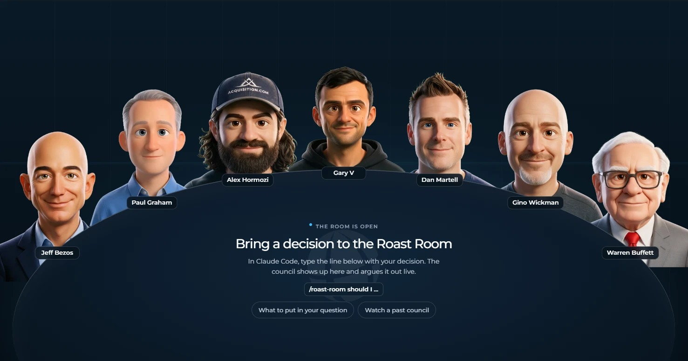

# Roast Room



Bring a new small-business venture idea (or any hard business decision) and seven AI advisors argue it out, then hand you a scored verdict and a one-click PDF. The seats are Jeff Bezos, Paul Graham, Alex Hormozi, Gary Vaynerchuk, Dan Martell, Gino Wickman, and Warren Buffett, each built from that person's public work: their letters, essays, talks, and videos. The council runs in Claude Code, and a small local web app shows them around a table talking it through.

| Seat | Pillar | The question they own |
|---|---|---|
| Jeff Bezos | Strategy and decisions | Is this the right bet, and how reversible is it? |
| Paul Graham | Product and startups | Do people actually want this, and is it growing? |
| Alex Hormozi | Offers, pricing, and sales | Will people pay, how much, and how do we close? |
| Gary Vaynerchuk | Marketing and attention | Where does the attention come from? |
| Dan Martell | People, hiring, and founder time | Who does this, and what does it cost your calendar? |
| Gino Wickman | Operations and scaling | Can the business run this without you holding it together? |
| Warren Buffett | Money and capital | What does it do to cash, risk, and long-term value? |

## What you need

- [Claude Code](https://claude.com/claude-code). Your Claude plan covers it; no API key needed.
- [Node.js](https://nodejs.org) 20 or newer, for the room. There's nothing to install beyond that.

## Setup

The room lives in its own folder. Claude Code only picks up the `/roast-room` skill and the seat agents when you open it there:

```bash
cd roast-room
```

Then fill in `business.md` with what you know about your venture: the idea, the first customer, your savings, startup costs, and your limits. The Chair reads it before every council, so you don't have to retype your numbers.

## Run a roast

1. Start the room: `npm start`, then open http://localhost:4730. Leave it open.
2. Open Claude Code in the same folder: `claude`
3. Type `/roast-room` and your decision.
4. Answer the Chair's questions, then watch the council argue it out in the room.
5. When the verdict lands, click **Download PDF**.

You also get a short verdict in Claude Code, and the full report lands in `sessions/<date>-<decision>/verdict.md`.

## What to put in your question

The council is only as good as what you give it. Include:

- **The decision** in one line.
- **Your options.** Two or three. "Keep doing what I do now" counts.
- **Your numbers.** Savings, startup costs, current income, and any revenue or customers so far.
- **Your limits.** Deadline, hours, and budget.
- **What success looks like**, and by when.
- **Which way you're leaning**, and why. The council tests your lean instead of agreeing with it.

Left something out? The Chair asks before the council starts. Example:

```
/roast-room I want to open a mobile coffee trailer in my town (pop. 40k). I have $35k saved
and a $62k day job. Should I buy a used trailer ($28k) and run weekends, lease a small cafe
space with a $90k loan, test at farmers markets with rented gear for 8 weeks first, or not
do it? Success is $4k a month profit within a year. I'm leaning toward the trailer.
```

For a venture that hasn't launched, the Chair always adds a test-first option (the smallest version that takes real money from strangers in 30 to 60 days) next to "don't do it".

More ways to run it:

- `/roast-room --quick ...` seats four advisors for two rounds. Use it for smaller, reversible calls. It uses far less of your plan.
- `/roast-room --seats hormozi,buffett ...` seats only the advisors you name.
- `/roast-room ask hormozi ...` gets one answer from one seat.

The room is optional. The council runs the same in Claude Code without it.

## Watch an example first

Run `npm start`, open http://localhost:4730, and click **Past sessions**. Three finished councils ship with the repo, so you can see how it works (and download their PDFs) before you run your own.

## How it works

- **The council runs in Claude Code.** Each seat is a sub-agent (`.claude/agents/council-*.md`) that reads its own brain (`.claude/skills/roast-room/brains/<name>/`): frameworks, principles, positions, stories, and voice notes compiled from public sources, with every quote tied to a source. Claude Code acts as the Chair. It runs the rounds, keeps score, and writes the verdict (`.claude/skills/roast-room/SKILL.md`).
- **Each seat scores every option**, weighted by how much that seat's pillar matters to your decision. The Chair caps the verdict when a seat flags ruin risk, and it forces a real argument when everyone agrees too fast.
- **The room only watches.** As the Chair works, it writes each step to `sessions/`, and the app plays those files back. Between rounds it shows which round is running, how long it has been, and what each advisor is weighing. The room makes no AI calls of its own.
- **Every council is saved** in `sessions/`. Past sessions replays any of them and downloads its PDF.
- **Usage:** a full council is 21 sub-agent runs, so it takes a real bite out of your plan's usage. Use `--quick` for small calls.

## Optional: let the room run councils itself

If you'd rather type a decision straight into the room, copy `.env.example` to `.env`, add an `ANTHROPIC_API_KEY`, set `COUNCIL_RUNNER=api`, and restart `npm start`. That mode bills your Anthropic API account (about 25 calls per full council).

## What's inside

| Path | What |
|---|---|
| `.claude/skills/roast-room/` | The skill: protocol, prompts, scoring, report template, and the seven brains |
| `.claude/agents/` | The seven seat agents |
| `app/` | The room: a zero-dependency Node server, the web page, and the PDF builder |
| `sessions/` | Your councils (kept out of git) and the three examples |
| `business.md` | Your venture notes; the Chair reads them before every council |

## About the advisors

These are simulations built from each person's public work. They are not the people, they don't speak for them, and none of them is affiliated with or endorses this project. A seat only quotes a person verbatim when the line is in its brain with a source, and `python .claude/skills/roast-room/scripts/check_quotes.py sessions/<session>` checks every quote in a council against the brains. Each brain's `sources.md` lists what it was built from.

Adapted from [nateherkai/roast-room](https://github.com/nateherkai/roast-room) by AI Automation Society. The seven brains, seat agents, and portraits come from that project unchanged; this copy swaps in its own branding and tunes the brief for new ventures (`business.md`, venture sample questions). The code is MIT licensed; see `LICENSE`. The PDF builder bundles [jsPDF](https://github.com/parallax/jsPDF) (MIT) and [Montserrat](https://github.com/JulietaUla/Montserrat) (SIL Open Font License); their licenses sit next to them in `app/public/`.
